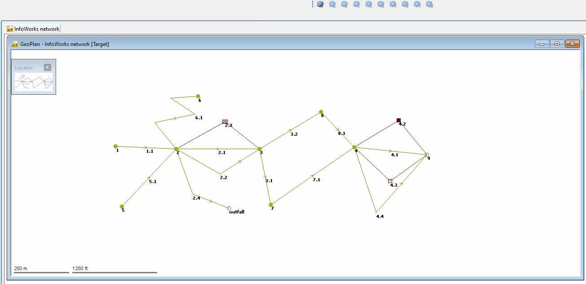
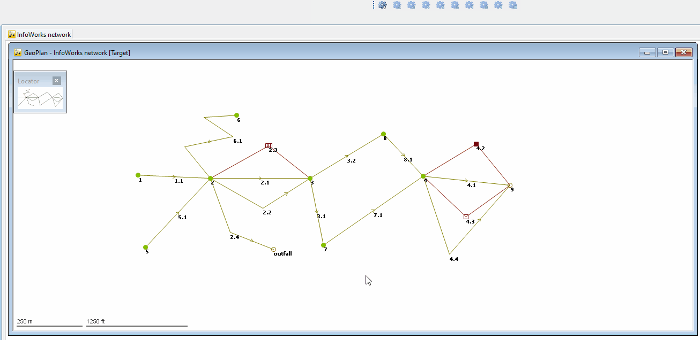
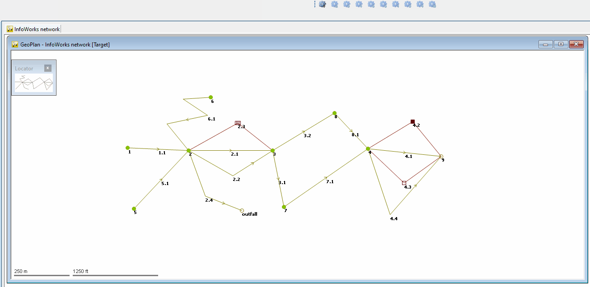

# Network Tracing

These scripts trace a connected path of nodes and links starting from the current selection, walking either downstream or upstream from either a node or a link selection. All four scripts share the same breadth-first traversal logic; only the starting object type (node/link) and the direction of travel (downstream/upstream) differ.

| Script | Starting selection | Direction | Demo |
|--------|---------------------|-----------|------|
| [UI_Script_v1.rb](UI_Script_v1.rb) | Nodes (`_nodes`) | Downstream |  |
| [UI_Script_v2.rb](UI_Script_v2.rb) | Nodes (`_nodes`) | Upstream |  |
| [UI_Script_v3.rb](UI_Script_v3.rb) | Links (`_links`) | Downstream |  |
| [UI_Script_v4.rb](UI_Script_v4.rb) | Links (`_links`) | Upstream |  |

## How it works

Each script runs the same traversal, swapping `ds_links`/`ds_node` for `us_links`/`us_node` depending on direction, and seeding the queue from either the node or link selection depending on starting object type:

1. Reads the current selection (nodes or links, per the table above) from the open network.
2. Seeds a queue (`unprocessedLinks`) with every link directly connected to the selection in the chosen direction, marking each as `_seen` to avoid re-queuing it.
3. Pops links off the queue one at a time and marks each as `selected`.
4. For each popped link, looks at the node on the far side (`ds_node` or `us_node`). If that node hasn't been visited, it's marked `selected`, and all of its links in the chosen direction are added to the queue (if not already `_seen`).
5. Repeats until the queue is empty — i.e. every node and link reachable in that direction from the original selection has been selected.

The `_seen` flag is a transient marker on the row object (not a persisted field) used purely to prevent revisiting the same link twice during the trace.

## Usage

1. Open a network in InfoWorks ICM.
2. Select one or more nodes (for `v1`/`v2`) or links (for `v3`/`v4`) in GeoPlan.
3. Run the matching script from the table above.
4. The full downstream or upstream path from your selection is now selected in the network.
