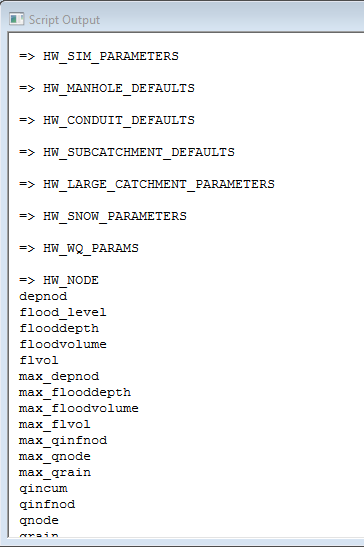

# List all results fields in a simulation

This [script](UI_script.rb) lists available **results** field names for each table on the open simulation network (`current_network`).

Open simulation results on the GeoPlan before running the script.

