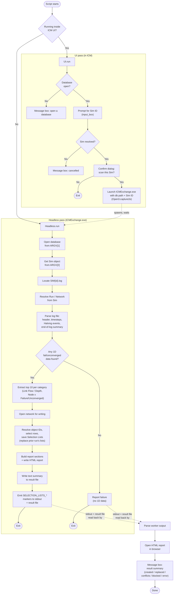

# Top 10 fail / unconverge (standalone)

Self-contained ICM UI script that reads `SIM{id}.log`, creates **top 10** selection lists per fail/unconverge category (SIMULATING phase), and opens a short HTML summary in your browser.

## What to copy

Copy **`UIIE_top10_fail_unconverge.rb`** and paste into a Ruby script object. Everything is in that one file (no extra folders or suite files).

## How it works

When you run the script from the UI and enter a Sim ID, it automatically starts a short **ICMExchange** run on the **same script file** with your database path and Sim ID. That headless pass reads the log, writes selection lists into the database, and builds the HTML summary. You do not open ICM Exchange or run command-line steps yourself.

### Process flow

## UI workflow

1. Open the database. Do not have the **latest version** of the simulation's model network open in GeoPlan — it stops the background task from saving selection lists. Older (read-only) versions and other networks can stay open.
2. Run the script; confirm **Yes**, then enter the **ID** of the completed Sim when prompted (right click > properties > ID, or "show details" in the database tree). Opening a Sim in the Geoplan view first does **not** currently feed into this prompt — you always need to type the ID.
3. Review the **HTML summary** that opens in your browser. A message box confirms completion and tells you where to find the new selection lists.
4. If the browser does not open, the completion message box shows a text summary and the temp HTML path instead.
5. **Refresh the database tree** and open **`Sim{n} Diagnostics`** for the new selection lists.

Selection lists are built in the headless pass by opening the **model network** (writable latest commit), selecting log object IDs, then calling `save_selection`. All six category lists are saved directly into the single `Sim{n} Diagnostics` group.

## Prerequisites

- `SIM{id}.log` exists in local results folder (Cloud results download summary or full results).
- Diagnostic logging was active on the simulation.

## Optional configuration

If the script cannot find ICMExchange on your PC, set `ICM_EXCHANGE_PATH` at the top of the script to the full path of `ICMExchange.exe`. This is install detection only — you still run the tool from ICM Scripts.

## Limitations

**Re-running.** List names are fixed per category and network commit (`Top 10 {Category}_v{commit_id}`), so re-running against the **same** commit replaces that commit's lists rather than duplicating them. Two rare failure cases are reported in the completion message:

- The old list can't be deleted: it is left untouched and no new list is created for that category.
- The old list is deleted but saving its replacement fails: that category is left with no list, and the message recommends running the script again.

**Which objects are listed.** Lists contain only log top-10 IDs that can be found on the **latest** network. Missing IDs are listed in the HTML report and text summary, and are not backfilled with lower ranks.

- IDs are matched ignoring case, because the log writes them in upper case.
- Pre-processor child objects that are not in the network are mapped to their parent, which is added to the same category list. The report shows **Yes (via ...)** for these.

| Log ID suffix | Parent added to the list |
|---|---|
| `_O` (e.g. `MH1_O.1`) | Node `MH1`, plus any culvert attached to it |
| `_L` / `_R` | River reach starting at that node |
| `_BO` / `_BE` / `_BC` | Bridge starting at that node |
| `_brk` | ARVB node, or the renamed conduit downstream of it |

Child IDs whose parent can't be found (including `dum_...` IDs) show **No - child object, check node ID and attached links**.

**Category %** is each object's share of the total counts in that category from the log.

## Troubleshooting

| Symptom | What to try |
|---------|-------------|
| Script says ICMExchange was not found | Set `ICM_EXCHANGE_PATH` in the script header |
| Script says lists could not be saved because the network is open in GeoPlan | Close the latest version of that network, then run again. This message is a best guess: it appears whenever saving fails while any version of that network is open, so if it persists with only read-only versions open, the cause is something else |
| No result marker / log analysis failed | Check the error dialog; confirm Sim ID, database, and that results exist locally (cloud: download results first) |
| No lists created | Confirm the log has 1D data; check that the Run/network still resolves |
| Report did not open in browser | Use the text summary in the completion message or the temp HTML path shown there |
| List has fewer than 10 objects | Expected if log IDs are not on the latest network — the HTML report's **In latest network?** column and the text summary both list which IDs were skipped |
| List has more than 10 objects | Expected when a child object resolves to more than one parent (e.g. a node and its culvert) |
| Row shows **No - child object, check node ID and attached links** | A pre-processor child ID whose parent could not be found. Look up the node named in the ID and the links attached to it |