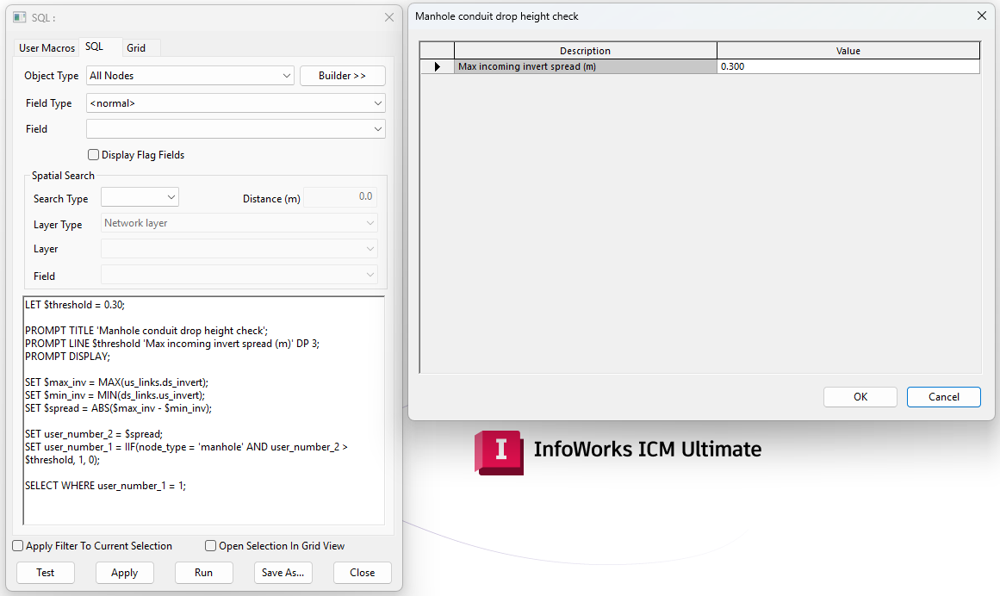

# Select manholes with a drop between incoming and outgoing conduits

This SQL query identifies manholes where there is a drop between the incoming and outgoing conduit inverts, and selects them for assessment.

## How it works

1. **Threshold**: the user is prompted for the maximum acceptable invert difference (default `0.30` m).
2. **Highest incoming invert**: `MAX(us_links.ds_invert)` returns the highest downstream invert level of the conduits flowing into the node.
3. **Lowest outgoing invert**: `MIN(ds_links.us_invert)` returns the lowest upstream invert level of the conduits flowing out of the node.
4. **Spread**: the absolute difference between the two is stored in `user_number_2`.
5. **Flag**: `user_number_1` is set to `1` for manholes where the spread exceeds the threshold, and `0` otherwise.
6. **Selection**: nodes with `user_number_1 = 1` are selected.

## Usage

1. Set **Object type** to **All Nodes** and leave **Spatial search** blank.
2. Run the query and enter the threshold in the dialog.
3. Review the selected nodes. The calculated drop is available in `user_number_2`.

## Notes

- The query overwrites `user_number_1` and `user_number_2` on all nodes. Change these fields if they hold data you need to keep.
- Only nodes with `node_type = 'manhole'` can be flagged.
- The query works with `ds_invert` and `us_invert`, so it considers conduits only.

## SQL dialog

